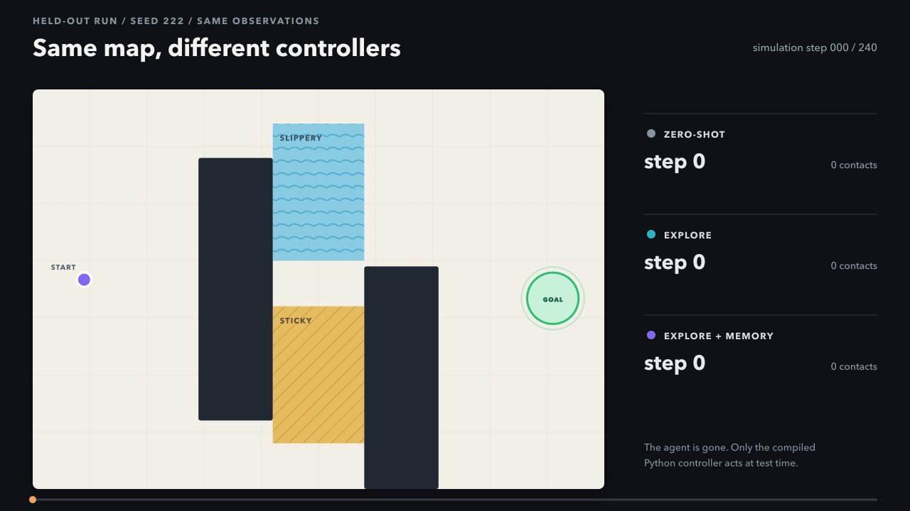
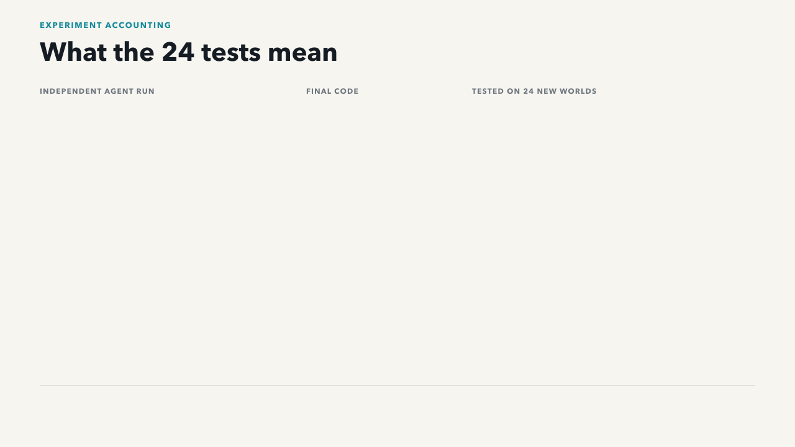

# Does exploration survive compilation?

A small, controlled experiment inspired by [RAX: Scaling Online Exploration for Robot Agents](https://arxiv.org/abs/2610.22496).

The experiment asks two questions:

1. Does online interaction help a coding agent produce a better standalone controller?
2. Does a persistent memory file add value beyond interaction alone?

**Classroom bundle:** [open all 24 held-out GIFs, the three controllers, and `memory.md`](classroom_artifacts/README.md).



### How to read the comparison

- **Gray, zero-shot:** no practice episodes and no memory file.
- **Blue, exploration:** 12 practice episodes, but no persistent notes.
- **Purple, exploration + memory:** the same 12 practice episodes, plus a persistent memory file.

Gray versus blue isolates the effect of online exploration. Blue versus purple tests whether persistent memory adds value after holding the exploration budget fixed.

### How many runs are in this result?



There is one independently generated controller per condition. Each controller is evaluated on 24 new worlds, so the table contains 72 controller evaluations but only one independent replicate per condition.

To inspect the artifacts directly:

- Zero-shot controller: [`runs/codex_zero_01/controller.py`](runs/codex_zero_01/controller.py)
- Exploration controller: [`runs/codex_nomemory_strict_01/controller.py`](runs/codex_nomemory_strict_01/controller.py)
- Exploration + memory controller: [`runs/codex_full_strict_01/controller.py`](runs/codex_full_strict_01/controller.py)
- Persistent memory: [`runs/codex_full_strict_01/workspace/memory.md`](runs/codex_full_strict_01/workspace/memory.md)
- Episode-by-episode development log: [`runs/codex_full_strict_01/workspace/run_log.md`](runs/codex_full_strict_01/workspace/run_log.md)

## Result from the first replicate

The same coding model received the same task and controller interface in all three conditions. The two exploration conditions received 12 episodes. Every final controller then ran alone on the same 24 held-out episodes.

| Condition | Exploration episodes | Held-out success | Total contacts | Mean steps when successful |
|---|---:|---:|---:|---:|
| Zero-shot | 0 | 23 / 24 | 100 | 191.3 |
| Exploration, no memory | 12 | 24 / 24 | 0 | 124.2 |
| Exploration + memory | 12 | 24 / 24 | 0 | 151.8 |

Online feedback improved the reliability of the compiled controller in this replicate. Persistent memory did not show an additional benefit: both explored controllers had the same success and contact rate, while the no-memory controller finished faster.

That is not evidence that memory is useless. Each condition currently contains one independently generated controller. The 24 held-out episodes measure the robustness of that controller across environments, not variation across independent agent runs.

## Experimental conditions

### Zero-shot

The agent reads the task and public observation contract, then writes `controller.py` without interacting with the environment.

### Exploration, no memory

The agent receives 12 online episodes. It may use observations from the current session, but only the final controller is retained.

### Exploration + memory

The agent receives the same 12-episode budget and can maintain `memory.md`, `skills.md`, and `run_log.md` while developing its controller.

In every condition, evaluation removes the coding agent. Only the compiled Python controller acts on held-out seeds.

## What is stored for every run

Each folder in [`runs/`](runs/) is an immutable experiment record containing:

- the exact condition prompt;
- the generated `controller.py`;
- model and budget metadata;
- episode-level held-out results and trajectories;
- persistent notes and exploration logs when the condition permits them.

The current runs are listed in [`runs/manifest.json`](runs/manifest.json). Future replicates should always use a new run ID rather than overwriting an existing folder.

## Reproduce the evaluation

No third-party Python packages are required.

```bash
python3 -m unittest discover -s tests
python3 evaluate.py \
  runs/codex_zero_01/controller.py \
  runs/codex_nomemory_strict_01/controller.py \
  runs/codex_full_strict_01/controller.py
python3 scripts/summarize_runs.py
```

The final command rebuilds [`results/run_summary.md`](results/run_summary.md) and [`results/run_summary.csv`](results/run_summary.csv) directly from the run folders.

## Add a new independent run

Create a new isolated run directory:

```bash
python3 scripts/prepare_run.py codex_nomemory_02 --condition no_memory
```

Run the coding agent with that new folder as its working directory. After it produces `controller.py`, score it from the repository root:

```bash
python3 scripts/score_run.py runs/codex_nomemory_02 --model MODEL_NAME
python3 scripts/summarize_runs.py
```

Never reuse an existing run ID. Independent run directories are the unit of replication.

## Suggested classroom walkthrough

1. Play the GIF above and point out the late zero-shot correction.
2. Open [`results/run_summary.md`](results/run_summary.md) to compare all three conditions.
3. Open the three generated controllers to show that evaluation runs code, not the language model.
4. Open [`runs/codex_full_strict_01/workspace/memory.md`](runs/codex_full_strict_01/workspace/memory.md) to show what persistent memory contains.
5. End with the open question: does memory help after controlling for online interaction and variation across agent runs?

A short spoken walkthrough is available in [`docs/classroom_walkthrough.md`](docs/classroom_walkthrough.md).

## Repository map

```text
runs/                 immutable agent-run records
src/                  hidden-physics simulator
controllers/          reference controllers used to validate the harness
scripts/              prepare, score, and summarize runs
results/              summaries generated from run records
assets/               classroom visualization
tests/                determinism and benchmark checks
```

## Scope and limitations

- This is a small mechanism test, not a reproduction of the full RAX robotics system.
- The environment exposes geometry and terrain labels, so the experiment does not evaluate visual perception.
- Held-out seeds vary layout and dynamics within the same simulator family.
- The current memory comparison has one independent controller per condition.

## Paper

Huang et al., [*Scaling Online Exploration for Robot Agents*](https://arxiv.org/abs/2610.22496), 2026.

